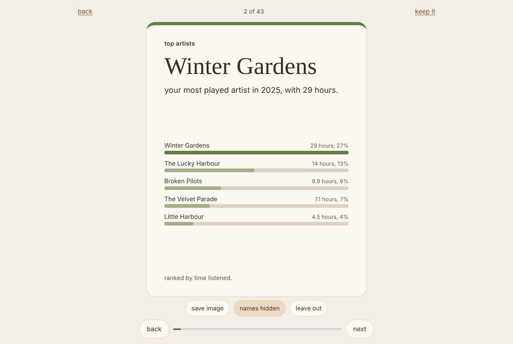

<p align="center">
  
</p>

<h1 align="center">attic</h1>

<p align="center">your year, from your own data. it runs in your browser. nothing is uploaded.</p>

<p align="center">
  
  
  
  
</p>

<p align="center">
  <a href="site/guides/index.html">how do i get my files?</a> ·
  <a href="docs/how-it-works.md">how it works</a> ·
  <a href="docs/faq.md">faq</a> ·
  <a href="DESIGN.md">design</a>
</p>

<p align="center">
  
</p>

## overview

drop in the files you can already download from the services you use. attic recognises each one, reads it in the page, and builds a deck of calm, full screen cards about your year: big numbers, top lists, a few small surprises. save any card as an image, or all of them. names are hidden in saved images unless you turn them on.

| source | the file | what attic counts |
|---|---|---|
| spotify | `Streaming_History_Audio_*.json` from the extended streaming history, or the smaller account data | hours, top artists, songs and album, your hour, night plays, longest session, discovery, skips, songs on repeat, podcasts |
| netflix | `ViewingActivity.csv` from the personal information download | hours, top shows, the big binge, shows tried and kept, late nights, devices, rewatches, each profile on its own |
| youtube | `watch-history.json` (or `.html`) from google takeout | videos, top channels, your hour, the rabbit hole, shorts, busiest day, new channels. never hours: the history has no lengths |
| chatgpt | `conversations.json` from the data export | conversations, words both ways, busiest day, longest conversation, code, your most used words (only when you ask), manners, the model mix |
| claude | `conversations.json` from the data export | the same as chatgpt, without models |
| your browser | `places.sqlite` (firefox, wren) or `History` (chrome, edge, brave) | an estimate of time online, top sites, busiest weekday, new sites, the longest rabbit hole, late nights |
| discord | `package.zip` from data and privacy | messages, busiest day and hour, servers against direct messages, days in a row, words, top servers and channels. never who you messaged |
| apple music | `Apple Music Play Activity.csv` from privacy.apple.com | the same deck as spotify, without artists when apple leaves them out |
| letterboxd | `diary.csv` from the data export | films, rewatches, ratings, your decade, busiest month, film night |
| goodreads | `goodreads_library_export.csv` | books, pages, the longest and oldest, your author, ratings |
| strava | `activities.csv` from the account archive | activities, distance by type, time moving, the longest, weeks in a row, climbing. never routes |
| steam | the saved licences page | games added and how they arrived. steam keeps no playtime by year |
| amazon | `Retail.OrderHistory.1.csv` from request your data | orders, items, spent per currency, the biggest order, bought again. never addresses or payments |

two or more sources make the last card richer: "your year in one page" picks the three or four numbers that stood out most.

## run it

nothing to install. node 22 or newer runs the tests and a small local server.

```
npm run serve
```

then open the address it prints. or build the single file and open it from your disk, with wi-fi off:

```
npm run build-single
```

that writes `dist/attic.html`, the whole app in one file.

| command | what it does |
|---|---|
| `npm test` | every unit, card and property test, in a few seconds |
| `npm run lint` | the house rules: no em dashes, emojis or buzzwords |
| `npm run privacy-scan` | fails on anything in `site/` that could send data out |
| `npm run test:browser` | the runtime privacy tests, accessibility and keyboard checks in chromium (needs playwright, and `npm install` for axe-core) |
| `ATTIC_SCALE=1 npm run test:scale` | a 300 mb json file and a million plays, with the time and memory they take |
| `ATTIC_VISUAL=1 npm run test:browser` | compares every card with stored images |
| `npm run make-fixtures` | writes the made-up exports in `tests/fixtures/` and the example year |
| `npm run walkthrough` | screenshots of every view at desktop and phone widths, light and dark |

deploying is one static folder, `site/`, with the headers in `vercel.json`.

## privacy

this is the product, so each promise has a test.

| promise | how | checked by |
|---|---|---|
| nothing leaves the page | `connect-src 'none'` in the header and in every page, and fetch, xhr, websocket and beacon replaced so they throw | `tests/privacy/runtime.test.js`: zero requests while every source is read |
| no third parties | no analytics, no fonts, no scripts from elsewhere | `npm run privacy-scan` |
| nothing is stored unless you ask | only "keep my results on this device" writes, and only the finished cards | the privacy scan, and the forget everything button |
| names stay out of shared images | sensitive cards are drawn from templates with the names left out | a pixel test: two different artists give the same hidden image |
| searches and page titles are never read | browser history keeps only site names and visit times | `tests/sources/browser.test.js` |
| you can check it yourself | the proof panel counts requests live; the single file runs offline | `tests/privacy/runtime.test.js` |

## layout

```
attic/
  DESIGN.md                the design this was built from
  vercel.json              headers only, and site/ as the folder to serve
  site/                    the only thing deployed
    index.html             the app
    guides/index.html      how to request each export, no javascript
    assets/                style.css and the logo
    vendor/                fflate and sql.js, with VERSIONS.md and licences
    sample/sample.js       the example year, made up
    src/
      app.js worker.js host.js
      ui/                  drop, found, progress, deck, proof, share
      core/                files, zip, jsonstream, csv, sqlite, timezone, store,
                           analysers, templates, cards, final, redact, doctor
      sources/             spotify, apple, netflix, youtube, chatgpt, claude, discord,
                           browser, letterboxd, goodreads, strava, steam, amazon
      render/              charts as svg or canvas, cards as images
      data/                guides.json (cc0), stopwords
  scripts/                 house rules, privacy scan, single file build, fixtures
  tests/                   unit, sources, privacy, browser, scale, visual, gen
  docs/                    how it works, faq, demo script, screenshots
```

## licence

[mpl 2.0](LICENSE). the guides data, `site/src/data/guides.json`, is [cc0](site/src/data/guides.LICENSE.txt). fflate and sql.js keep their mit licences, listed in [site/vendor/VERSIONS.md](site/vendor/VERSIONS.md).

attic is not affiliated with spotify, apple, netflix, youtube, google, openai, anthropic, discord, letterboxd, goodreads, strava, valve, amazon or any browser maker. their names appear only to say which file is which.

<p align="center"><sub>made by tuftle. part of the tuftle family, with <a href="https://github.com/Tuftle/wren">wren</a>, <a href="https://github.com/Tuftle/nook">nook</a> and <a href="https://github.com/Tuftle/burrow">burrow</a>.</sub></p>
